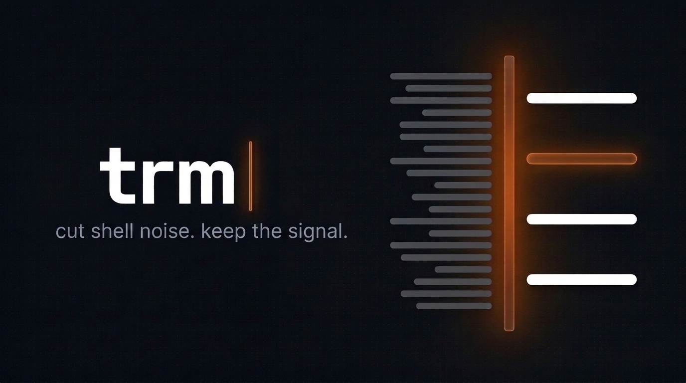

<p align="center">
  
</p>

<p align="center">
  <strong><code>trm</code> (shell-trim)</strong> — fast, zero-dependency Rust CLI that trims shell output for AI coding agents and tracks net context savings.
</p>

<p align="center">
  
  
  
  
  
  
</p>

---

## Why `trm`?

AI coding agents burn massive context on raw `cat`, `head`, `tail`, `sed -n`, `rg`, and `grep` output—repeated file paths, comment walls, and giant files dumped verbatim just to inspect one function.

`trm` sits directly at the shell layer so it works identically across **Codex**, **Antigravity**, **Claude Code**, **GitHub Copilot CLI**, **Pi**, and **Cursor**—trimming noise *before* bytes enter the context window or session transcript, while staying **edit-safe** so agents don't fail patches and re-read raw files.

<p align="center">
  
</p>

### Real-World Benchmarks
Measured on a 74-file production Swift macOS codebase and `shell-trim` itself (per-language bytes-per-token estimates, ~3.2–4.2 bytes/token):

| Command | Workload | Est. Raw Tokens | Est. Output Tokens | Saved |
|---|---|---:|---:|---:|
| `trm read` | `outline` (large Swift files) | 62,621 | 5,858 | **90.6%** |
| `trm read` | `auto` (all 74 Swift files) | 114,523 | 57,467 | **49.8%** |
| `trm rg` | grouped content search | 20,823 | 2,105 | **89.9%** |
| `trm rg --files` | directory-grouped listing | 1,648 | 568 | **65.5%** |
| `trm cargo test` | 89 Rust tests (all passing) | 1,730 | 10 | **99.4%** |
| `trm pipe` | 120-item JSON API payload (`cmd \| trm`) | 2,782 | 73 | **97.4%** |
| `trm ls -la src/` | compact directory listing | 283 | 76 | **73.1%** |
| `trm git log` | 20 commits (compact oneline) | 1,115 | 470 | **57.8%** |
| `trm find Sources/` | directory-grouped tree | 938 | 498 | **46.9%** |
| `trm find .` | repo root (hides `.git`/`target`) | 271,891 | 134 | **99.9%** |

*Typical day-to-day savings are around **50–75%**. The 90%+ rows are best-case workloads: `find .` mostly comes from skipping `.git/` and `target/`, `cargo test` is an all-passing run (failures are kept verbatim), and `outline` excludes any follow-up `-r` / `-s` drill-down.*

> See **[EXAMPLES.md](EXAMPLES.md)** for Before & After outputs and **[DESIGN.md](DESIGN.md)** for the empirical decisions behind `trm`.

---

## Quick Start

```bash
# 1. Install via Homebrew (macOS & Linux)
brew install misbeliever/tap/trm

# 2. Install always-on agent rules (Codex, Antigravity, Claude, Copilot, Pi, Cursor)
trm install

# 3. Verify PATH, agent rules, config, and telemetry
trm doctor
```

<details>
<summary>Or build from source (Rust, zero dependencies, compiles offline in &lt; 10s)</summary>

```bash
git clone https://github.com/misbeliever/shell-trim.git
cd shell-trim
cargo build --release
install -m 755 target/release/trm ~/.local/bin/trm
```

</details>

`trm install` inserts a compact, fenced `<!-- trm:start --> ... <!-- trm:end -->` block into your detected agent rule files (`~/.codex/AGENTS.md`, `~/.gemini/config/GEMINI.md`, `~/.claude/CLAUDE.md`, `~/.copilot/copilot-instructions.md`, `~/.pi/agent/AGENTS.md`, `~/.cursor/rules/trm.mdc`) without touching your existing rules. Pass `--hook` to also install zero-token `PreToolUse` rewrite hooks for **Antigravity (`agy`)** (`~/.gemini/config/hooks.json`) and **Claude Code** (`~/.claude/hooks/trm-rewrite.sh`). Remove cleanly anytime with `trm uninstall`.

---

## Commands

### `trm read` — Smart File Reading
Replaces `cat`, `head`, `tail`, and `sed -n`.

```bash
# Auto mode: raw (<=80L), minimal (81-260L), outline (>260L)
trm read Sources/App/DictationController.swift

# Jump directly to a function or type body (exact raw lines, 1 call)
trm read Sources/App/DictationController.swift -s finish

# Exact raw slice before editing
trm read Sources/App/DictationController.swift -r 150-175

# Quick peeks for logs & wide JSONL (replaces head/tail/cut)
trm read logs/events.jsonl --head 5 -c 300
trm read logs/app.log --tail 30

# Multi-file reads & explicit mode overrides
trm read src/a.rs src/b.rs
trm read src/big.ts --outline | --minimal | --aggressive | --raw
```

**How `auto` mode stays edit-safe:**
| Condition | Effective Mode | Behavior |
|---|---|---|
| `-r`, `--head`, `--tail`, `-s` | `raw` / `symbol` | Exact unmodified lines—never breaks exact-match edits (`-s` matches declarations containing the symbol name, e.g. Go `-s T` returns `type T` and its receiver methods) |
| `≤ 80` lines | `raw` | Zero overhead on small files |
| `≤ 80` lines & `≥ 12 KB` | `minified` | Truncates wide minified blobs safely in `auto` mode (`--raw` for full) |
| `81–260` lines | `minimal` | Strips non-doc comments & blank runs; **never-expand guard** falls back to `raw` if trimming wouldn't shrink output |
| `> 260` lines | `outline` | Collapses imports & bodies into declarations + `[Lstart-Lend]` ranges |

> First-class support for **Swift** (nested `/* /* */ */` comments, `///` docs, `// MARK:`, protocols, actors, extensions), **Rust**, **TypeScript/JS**, **Python**, **Go**, **C/C++/Obj-C**, **Shell**, **SQL**, **Markdown**, **JSON**, and **YAML**.

---

### `trm rg` (alias: `trm grep`) — Grouped Search + Auto-Block Expansion
Wraps real `rg` and forwards all standard flags (`-i`, `-F`, `-w`, `-g`, `-t`, `-C`, `--files`, `-l`, `-c`).
- **Broad searches (> 3 hits):** grouped by file, trimmed indentation, capped at 6/file & 50 total (180 chars/line).
- **Focused searches (1–3 hits):** automatically expands each match to its **enclosing function/method body** (or `±8` raw lines) so agents can edit in **1 tool call instead of `rg` → `read`**.

```bash
# Grouped & capped on broad queries; auto-expands enclosing block on 1-3 hits
trm rg "func " Sources/
trm rg "estimate_tokens" src/

# Directory-grouped file listing
trm rg --files Sources/

# Escape hatches
trm rg --all "TODO" Sources/
trm rg --block "foo" src/         # force block expansion
trm rg --no-block "foo" src/      # force compact 1-line list
```

---

### `trm swift` / `trm swiftc` & `trm cargo` — Build & Test Trimming
Strips compile progress (`[12/54] Compiling ...`, `Compiling foo v...`) and passing test lines (`Test Case ... passed`, `✔ Test ...`, `test ... ok`), keeping all compiler errors, warnings, failing test assertions, and a crisp summary.

```bash
trm swift build
trm swift test
trm swiftc main.swift
trm cargo build --release
trm cargo test
trm cargo clippy

# Escape hatch for full unmodified output
trm swift --raw test
trm cargo --raw test
```

---

### `trm git` — Compact Git Output
Compacts verbose `git status` (grouped staged/modified/untracked), `git diff` / `git show` (strips header boilerplate, auto-skips lockfiles, caps huge diffs with `--all`/`--raw`), and `git log` (defaults to `--oneline -n 20`). Other git subcommands and `git show <rev>:<path>` pass through untouched.

```bash
trm git status
trm git diff
trm git log
trm git show HEAD
```

*Note: `--raw` (and `--all` on `git diff` / `git show`) are handled as `trm` flags rather than forwarded to `git`; invoke `git diff --raw` directly if you need git's raw diff format.*

---

### `trm pipe` (`cmd | trm`) — Structured Stdin Trimming
Automatically activates when piping into bare `trm` (`cmd | trm`) or via `trm pipe`: summarizes large JSON payloads, truncates SQL/TSV tables to headers + sample rows, and collapses repeated timestamp-noisy log lines while preserving errors/warnings (`--raw` or `--all` for full).

```bash
curl -s https://api.example.com/events | trm
docker logs api --tail 500 | trm
```

---

### `trm ls` & `trm find` — Compact Directory & File Listing
Strips `ls -l` permission/owner/timestamp noise into grouped `dirs` and `files`, and directory-groups `find` output while auto-hiding `.git`, `.build`, `target`, `node_modules`, and `DerivedData` (`--all` / `--raw` for full output).

```bash
trm ls -la
trm find . -name "*.swift"
```

---

### `trm ui` (alias: `trm top`) — Zero-Dep Interactive TUI Dashboard
Live full-screen terminal dashboard (zero external crates, auto-refreshes every 2s):
- **KPI Header Cards**: Net saved + 7d sparkline, Adoption %, Health (misses/waste/1-call `rg`), and Turn-0 Tax
- **`[1] Overview`**: 2-column wide layout with Command breakdown & Agent/Model adoption
- **`[2] Agents`**: Per-agent and per-provider/model token savings
- **`[3] Misses`**: Recent trim misses, bypassed legacy commands & large passthroughs
- **`[4] Live`**: Live stream of `trm` commands (`p` to pause/resume)
- **`[5] Context`**: Turn-0 tax by agent, enabled skills by source & configured MCP servers
- Keys: `1–5` / `←→` / `Tab` switch views · `w` cycle window (`1h`/`24h`/`7d`/`all`) · `↑↓` / `j`/`k` / `PgUp`/`PgDn` scroll · `p` pause · `r` refresh · `q` quit

```bash
trm ui              # interactive dashboard
trm ui --once       # single snapshot frame
```

---

### `trm stats` (alias: `trm gain`) — Net Savings & Auto-Tuning
Unlike naive byte counters, `trm stats` tracks **net** estimated token savings (per-language bytes-per-token factors) by detecting **trim misses** (when the same agent/session immediately re-reads a file `--raw` or re-runs `rg --all` within 180s) and distinguishing them from intended **outline drill-downs** (`outline` → narrow `-r` slice).

```bash
trm stats -s 7d -a -m -l --misses --recommend
```

- `-s, --since <dur>` — time window (`1h`, `24h`, `7d`, `30d`, `all`)
- `-a, --by-agent` / `-m, --by-model` / `-l, --by-lang` — compare savings and miss rates across agents, models, and languages
- `-j, --json` — output stats as JSON
- `--misses` — list exact files/queries that triggered a raw re-read
- `--recommend` — analyze logged history and suggest concrete threshold tweaks
- **Sandbox-safe logging:** writes to `~/.local/share/trm/events.jsonl` when writable, spills to `/tmp/trm-events-<user>.jsonl` inside sandboxed agent shells, and auto-merges into the persistent log when you run `trm stats`

---

### `trm audit`, `trm export` & `trm inspect` — Adoption, Turn-0 Context & Reports
Scans your local **Codex**, **Antigravity**, **Claude Code**, **Copilot CLI**, and **Pi** session transcripts (read-only) to measure how often agents actually use `trm` vs. falling back to raw `cat`, `head`, `tail`, `sed -n`, `rg`, or `grep` — and audits static **turn-0** token bloat across rules, skill metadata, and MCP servers.

```bash
# Adoption % by agent and model over the last 24h
trm audit -s 24h -m

# Inspect the exact legacy commands agents are still running
trm audit -s 24h -b

# Audit turn-0 rule, skill & MCP config bloat (--probe-mcp queries stdio MCP schemas live)
trm audit --context
trm audit --context --probe-mcp

# Export shareable JSON report (--anon hashes repo/file paths while keeping extensions)
trm export -s 7d -o trm-report.json
trm export -s 7d --anon -o trm-anon.json

# Render a compact terminal summary from any exported JSON report
trm inspect trm-report.json
```

*Smart command classification ignores piped filters (`rg foo | head -n 10`, `ls | grep swift`), heredoc writes (`cat <<EOF > f`), and in-place edits (`sed -i`). Short flags: `-s` (`--since`), `-m` (`--by-model`), `-b` (`--bypasses`), `-j` (`--json`), `-o` (`--out`).*

---

### `trm install` / `trm uninstall` / `trm doctor`
```bash
trm install --dry-run            # preview changes
trm install                      # upsert fenced rule block across detected agents
trm install --only cursor        # target: codex | agy | claude | copilot | pi | cursor
trm install --hook               # install PreToolUse hooks (Antigravity hooks.json + Claude helper script)
trm doctor                       # verify PATH, agent rules, hooks, config & telemetry
trm uninstall                    # cleanly remove only the trm block & hooks
```

*Cursor tip: `trm install` writes `~/.cursor/rules/trm.mdc`, though some Cursor desktop IDE versions also require adding the rule under **Settings → Rules → User Rules**.*

---

## Configuration (`~/.config/trm/config.toml`)

All thresholds have sensible defaults and can be overridden via `~/.config/trm/config.toml` (or `$TRM_CONFIG`):

```toml
small_lines = 80
outline_lines = 260
minified_bytes = 12288
rg_max_total = 50
rg_per_file = 6
rg_max_chars = 180
reread_window_secs = 180
```

---

## Design Principles

- **Zero external crates** — pure Rust stdlib, compiles offline in `< 1s`, ~2ms startup.
- **Never-expand guarantee** — if trimming doesn't save bytes, `trm` transparently falls back to raw output.
- **Edit-safe by default** — slices (`-r`), peeks (`--head`/`--tail`), and symbol jumps (`-s`) always return exact unmodified lines.
- **Measure what matters** — tracks both **net savings** (after re-read waste) and **real adoption** (via session log audits).

## Development & License

```bash
cargo clippy --all-targets -- -D warnings
cargo test
cargo build --release
```

Licensed under the [MIT License](LICENSE). See [CHANGELOG.md](CHANGELOG.md) for release notes.
